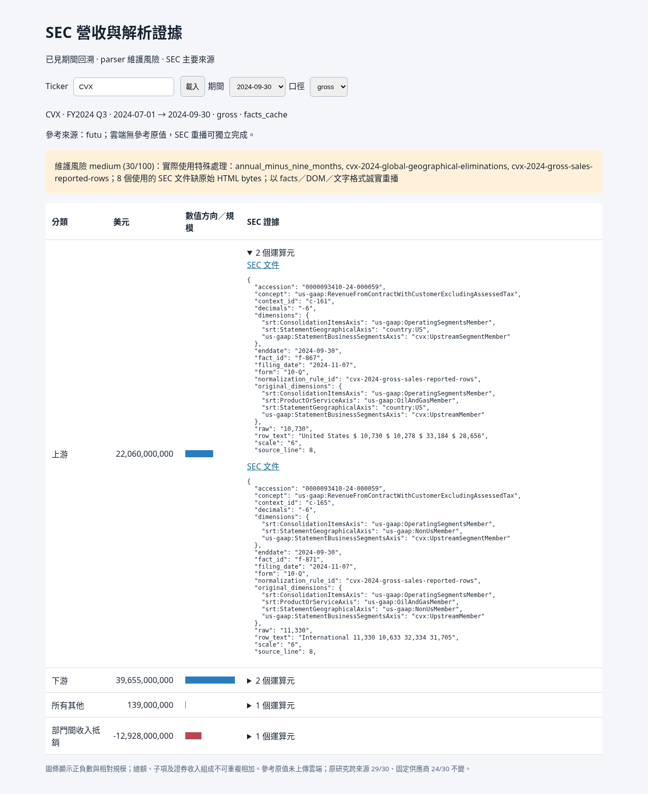

# 雲端引擎實測紀錄

驗證日期：2026-11-04（Asia/Taipei）。30 家／240 期／1,092 項凍結 SEC 數值、完整 scope、期間、URL、accession 與遞迴 FY／YTD9／合計運算元全部相同。每家公司相同輸入重跑兩次的業務 payload 完全一致，沒有未移植公司或目標期別。此數字是指定欄位回歸，不是完整披露召回率。

新舊共 184 項 unittest 通過。本 checkout 歷史測試實際 discover 164 項（與交接提及的 176 項不同），新增 20 項，包括三十家雙次重播、來源 hash、來源格式、拒絕缺值／衝突、替代式不重複加總、零售會計年度、近期風險、真實新增 ticker 行為隔離及 viewer 錯誤查詢。

Chromium 在雲端以正常 UI 逐家輸入全部 30 個 ticker，各有八個實際期別。另實測 CVX net 預設、gross 切換、最舊期別、證據展開、非法 ticker 清除舊資料、缺期／錯誤 basis 的 404 與非法參數的 400；沒有 JavaScript 頁面錯誤。可重跑 `python scripts/check_sec_viewer_ui.py`。

## 真實來源缺口

來源索引包含 263 份申報 facts cache、13 份真正 HTML、10 份 DOM 快照、3 份工具文字。facts cache 對應的 250 份申報仍缺原始 HTML bytes；這是申報數而非目標季度數。每份 gzip 與原始 bytes hash 皆保留；未製造 HTML。`data/sec/TICKER/original-downloads.json` 另列原下載 manifest（包括缺 bytes 的 submissions JSON），`index.json` 列實際可用 capture。

原始 HTML 僅 PGR 五份與 shared-raw-semantics 八份；Comcast 由 HTML 與 DOM 混合重剖，CAT 最新期由 SEC 8-K DOM 表重剖，UPS 最新期由 SEC 工具文字重剖，XOM 舊 CIK 由 DOM／文字重剖，最新 CIK 由 facts 重播。其餘主要重播來源是 hash 驗證過的原擷取 facts，不宣稱從遺失 HTML 重新抽取 tags。

沒有執行新 SEC 下載：缺真實聯絡設定時離線工作仍完整可用。下載引擎單次正常 GET 的 403 停止行為有 mock 測試；尚無此環境的新下載成功實測。

## 逐家公司回歸與風險

| Ticker | 目標期 | 基準輸出 | 完整回歸差異 | 主 basis | 維護風險 | cache 申報缺原始 HTML |
|---|---:|---:|---:|---|---|---:|
| AAPL | 8 | 40 | 0 | reported | medium (20) | 9 |
| MSFT | 8 | 23 | 0 | reported | medium (45) | 9 |
| NVDA | 8 | 16 | 0 | reported | medium (30) | 9 |
| ORCL | 8 | 32 | 0 | reported | medium (20) | 9 |
| GOOGL | 8 | 56 | 0 | reported | medium (20) | 9 |
| META | 8 | 24 | 0 | reported | medium (20) | 9 |
| DIS | 8 | 24 | 0 | reported | medium (20) | 9 |
| CMCSA | 8 | 16 | 0 | reported | medium (20) | 7 |
| AMZN | 8 | 56 | 0 | reported | medium (25) | 9 |
| TSLA | 8 | 24 | 0 | reported | medium (20) | 7 |
| HD | 8 | 32 | 0 | reported | medium (40) | 9 |
| MCD | 8 | 24 | 0 | segments | medium (25) | 9 |
| WMT | 8 | 32 | 0 | segments | medium (20) | 9 |
| COST | 8 | 16 | 0 | reported | medium (20) | 9 |
| PG | 8 | 48 | 0 | reported | medium (20) | 9 |
| KO | 8 | 57 | 0 | reported | medium (25) | 9 |
| JNJ | 8 | 16 | 0 | reported | medium (20) | 9 |
| UNH | 8 | 24 | 0 | reported | medium (20) | 7 |
| LLY | 8 | 40 | 0 | reported | medium (30) | 9 |
| JPM | 8 | 32 | 0 | reported | medium (25) | 9 |
| BAC | 8 | 40 | 0 | reported | medium (25) | 9 |
| BRK-B | 8 | 64 | 0 | segments | medium (20) | 9 |
| PGR | 8 | 96 | 0 | reported | low (5) | 4 |
| XOM | 8 | 60 | 0 | segments | high (65) | 2 |
| CVX | 8 | 32 | 0 | net | medium (35) | 9 |
| CAT | 8 | 48 | 0 | reported | high (65) | 9 |
| UPS | 8 | 24 | 0 | reported | high (60) | 9 |
| NEE | 8 | 24 | 0 | segments | medium (35) | 7 |
| LIN | 8 | 40 | 0 | reported | medium (20) | 9 |
| PLD | 8 | 32 | 0 | reported | medium (20) | 9 |

每家公司分數、近期比較日期、schema hash、實際特殊規則 ID 與可讀理由見同目錄 `cloud-engine-verification.json`，以及每期輸出 `risk`。缺值至少加 50 分，歷史不足加 40 分，最近兩次 schema 差異每欄加 5 分上限 40，實際特殊規則每個 5 分上限 25，缺原始 HTML 加 15 分；20 分以上 medium，50 分以上 high。schema 包括正規化前後完整維度與遞迴運算元。

CVX 八期 net 都可由 SEC 對帳，舊 2024Q3 以完整兩地區 gross 加負抵銷建立 net，原始 scope 與合計運算元保留。八期 gross 凍結回歸仍相同；主系列切換不增加獨立驗證數。XOM 既有研究的兩個 Q2 五欄 gross-sales 例外保留具名 rule_id，其餘分部 all-income 與扣回欄不混稱同一 scope。

參考原始金額沒有上傳雲端；registry 只含 manifest 的來源選擇、逐期例外與舊明細 hash。公司申報副本與 SEC 共源，不能算獨立驗證。跨來源 29/30、固定供應商 24/30 保持原研究定義，全部期間已見，不稱盲測。

## 重跑與服務入口

從 repo 根目錄執行 README 的安裝、`python scripts/replay_sec.py ALL`、`python scripts/check_engine_regression.py`、`python -m unittest discover -s tests -q`、`python scripts/serve_sec_viewer.py`。Viewer 使用雲端埠 8765；外部存取需要雲端環境的埠預覽／轉送。沒有公開部署，也不需 Mac 開機。這輪驗證中的服務使用 `--data data/engine-check`，預設命令使用已另產生的 `data`。
