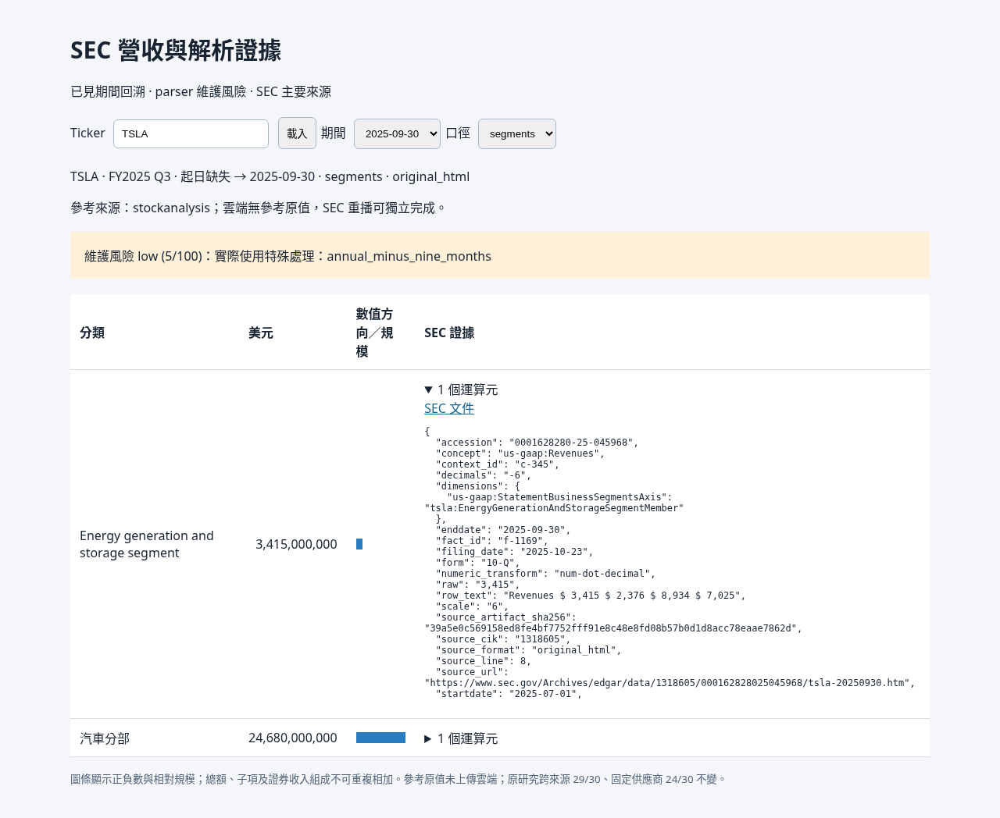

# 分階段工作流驗證

2026-11-04（Asia/Taipei）於 Codex Cloud 完成。新正式入口為 `scripts/sec_pipeline.py`；本機操作命令見 [local-workflow.md](local-workflow.md)。原研究與凍結 hash 不改寫，原跨來源 29/30、固定供應商 24/30 成績不變。

## 可用行為

- `tickers` 列出30家支援公司；download／extract 可用多個 ticker、逗號清單或文字／JSON 清單。
- `download` 查 SEC recent 與歷史 submissions，依實際 reportDate 範圍選取，或刷新並更新至最新。metadata與原始 HTML 持久快取，沒有 force 就驗證後沿用，force 發出新 GET 並保留不同 bytes。
- 自動納入 Q4 的 YTD9、公司已審閱的比較欄依賴及 PGR 合併 Exhibit 13。CAT／UPS 已審閱的 8-K 將事件日期與實際季度分開。未知來源／新披露不偽稱已支援。
- `extract` 只讀下載 cache，禁止連網、禁止讀 research 供應數字。成功且來源／規則 fingerprint 相同時跳過；force 可重新萃取。公司獨立規則指紋不包含其他公司模組。缺值或失敗不當成完成。
- CVX net 與 XOM all-income 有成分對帳，容差只取實際 SEC 運算元申報精度；保留原數、差額與所有運算元。不能對帳時拒絕。
- `viewer` 讀固定輸出與索引，可看任意已萃取期間。部分期間萃取不刪除舊期索引；不同來源／規則版本另存。

## 實際通過

219 項 unittest 全部通過，包含原有184項與新增35項。新增案例涵蓋下載 cache hit、force／新 bytes 版本、latest 發現新期、歷史分頁與更新後保留舊 cache、離線、403 停止、來源 hash 損壞拒絕、附件中斷安全續跑、原文變動使萃取失效、成功時跳過、force 重剖、缺輸出重建、公司隔離、CIK 不混接、DEI日期、未知數字 transform 拒絕、明確 XBRL zero transform 與真正缺值區分、對帳失敗及 viewer 索引保留。

| 驗證 | 結果 | 界限 |
|---|---|---|
| 三十家公司下載→萃取→再次 cache hit 契約 | 30家通過 | 多數是明標 synthetic inline fixture，驗證流程契約，不當成30家最新原始申報準確率 |
| 真實已存 HTML 重剖 | TSLA、UNH、NEE、CMCSA、PGR，13份來源／13個公司期別 | 82個數值與完整遞迴 SEC 運算元全部吻合；HTTP transport 是fixture，不是新線上下載 |
| 舊研究回歸 | 30家／240期／1,092項零差異 | 不提高原研究完成數，不稱盲測 |
| 真正 CLI 子程序 | offline download → force extract → cache-hit extract | 使用8份未改動真實 HTML；lab 的 submissions metadata 是明標fixture |
| Chromium＋實際 HTTP server | TSLA、UNH、NEE、CMCSA，各兩期 | 新流程輸出資料、ticker／日期／basis切換、證據展開、非法輸入與HTTP錯誤皆通過，無JavaScript錯誤 |

所有財報數值來源的13份真正 HTML 都保持原始 bytes。PGR年報的 parent-only primary 在測試中是明標 synthetic 佔位文件，只測下載文件組，不提供任何財報數值；收入全部取真正已存的合併 Exhibit 13。CAT／UPS 新8-K HTML adapter 以明標 synthetic layout／DOM衍生fixture驗證，尚未取得並實測這兩份新的原始 HTML，沒有將快照假裝成原始 bytes。

## 尚未實測的外部部分

此雲端 session 沒有已提供的真實 SEC_USER_AGENT，因此沒有執行新的 SEC 線上成功批次下載，沒有為湊通過而猜測身分。SEC HTTP拒絕停止、索引刷新、force與cache控制由注入fixture驗證。使用者本機首次實際連網需設定真實識別與聯絡email；已有完整cache後可離線下載檢查、萃取與開viewer。

本環境目前沒有跨chat傳訊／喚醒工具，未通知或遠端操作本機session。程式與文件可由本機安全pull後直接執行，不需要雲端web preview。

機器收據與來源hash見 [workflow-verification.json](workflow-verification.json)。這份紀錄保留成功範圍與上述限制，不宣稱250份缺原文的申報已全部補齊或重剖。
